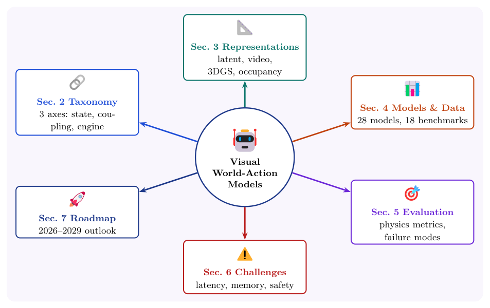
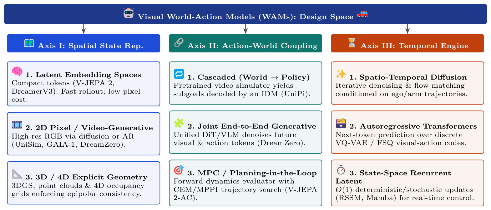
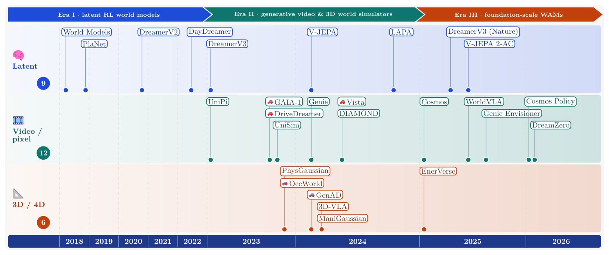
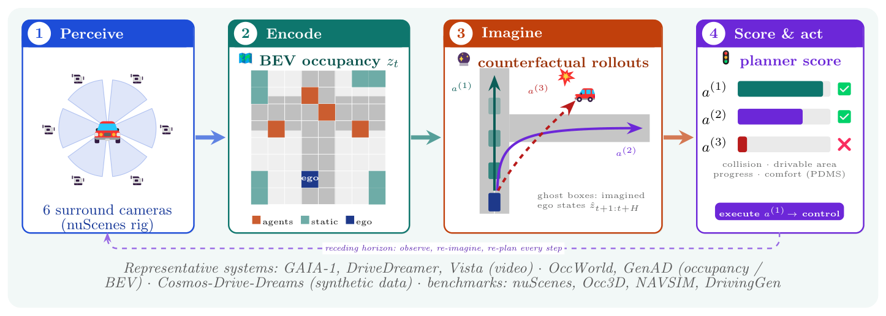

# Awesome Visual World-Action Models

Companion repository for the survey **"Visual World-Action Models for Embodied AI and Autonomous Driving: A Systematic Survey of Spatial Representations, Generative Dynamics, and Benchmarks"** (Singh and Lobo, submitted to *The Visual Computer*).

It contains:

- a curated, taxonomy-ordered **paper list** (robotics and autonomous driving);
- **leaderboards** of results as reported by the original papers (NAVSIM, nuScenes, Occ3D, LIBERO, CALVIN);
- **`wamscore`**, a reference implementation of the three physics-grounded diagnostics proposed in the survey (IVR, E_dn, Δ_act);
- all **figures** of the survey as vector PDF and 300-dpi PNG, free to reuse with attribution.

Contributions of papers and newly reported results are welcome — see [How this list stays current](#how-this-list-stays-current).

<!-- BEGIN:STATS -->
  
<!-- END:STATS -->
[](https://doi.org/10.5281/zenodo.XXXXXXX)
[](../../actions/workflows/arxiv-watch.yml)

## What's new

<!-- BEGIN:NEWS -->
_No additions since the survey was submitted yet. New papers appear here automatically._
<!-- END:NEWS -->

## How this list stays current

- **Every Monday** a GitHub Action searches arXiv for new world-model and world-action-model papers and opens an issue listing candidates ranked by relevance.
- A maintainer ticks the relevant ones and comments `/add <arXiv-ID> <category>`, or anyone opens an [**Add paper**](../../issues/new?template=add-paper.yml) issue. A bot fetches the title, authors and year from arXiv and opens a pull request.
- Merging the pull request rebuilds this README, the leaderboards and [`docs/papers.bib`](docs/papers.bib) automatically.
- On the **1st of every month** the repository is released as a new version, which [Zenodo](https://zenodo.org) archives with a citable DOI.



## Contents

- [Taxonomy](#taxonomy)
- [Leaderboards](#leaderboards)
- [Physics-grounded metrics (`wamscore`)](#physics-grounded-metrics-wamscore)
- [Paper list](#paper-list)
- [Figures](#figures)
- [Citation](#citation)

## Taxonomy

World-Action Models (WAMs) jointly model future world states and actions, p(z_{t+1:t+H}, a_{t:t+H-1} | o_{1:t}, a_{1:t-1}, l). The survey organizes them along three axes:

| Axis | Options |
|---|---|
| I. Spatial state | latent embeddings · 2D pixel/video · 3D/4D explicit geometry (3DGS, occupancy, point clouds) |
| II. Action–world coupling | cascaded (world → policy) · joint end-to-end · planning-in-the-loop (MPC / trajectory scoring) |
| III. Temporal engine | spatio-temporal diffusion / flow matching · autoregressive transformers · state-space recurrent latents |




## Leaderboards

<!-- BEGIN:LEADERBOARDS -->
Numbers are copied from the original papers (the `source` column says when a paper's number was taken from another paper's table). Nothing is re-run. Compare only within one table. Best value per column is bold.

### CALVIN ABC->D, average tasks completed in a row (out of 5) ↑

| Method | avg_len | Source |
|---|---|---|
| [DreamVLA](https://arxiv.org/abs/2507.04447) | **4.44** | original |
| [VPP](https://arxiv.org/abs/2412.14803) | 4.33 | original |
| [Seer](https://arxiv.org/abs/2412.15109) | 4.28 | original |
| [GR-1](https://arxiv.org/abs/2312.13139) | 3.06 | original |
| [SuSIE](https://arxiv.org/abs/2310.10639) | 2.69 | original |
| [UniPi](https://arxiv.org/abs/2302.00111) | 0.92 | as reported by VPP |

### LIBERO success rate (%) ↑

| Method | Spatial | Object | Goal | Long | Avg | Source |
|---|---|---|---|---|---|---|
| [Cosmos Policy](https://arxiv.org/abs/2601.16163) | **98.1** | **100.0** | **98.2** | **97.6** | **98.5** | original |
| [OpenVLA-OFT](https://arxiv.org/abs/2502.19645) | 97.6 | 98.4 | 97.9 | 94.5 | 97.1 | original |
| [UniVLA](https://arxiv.org/abs/2505.06111) | 96.5 | 96.8 | 95.6 | 92.0 | 95.2 | as compiled by Cosmos Policy |
| [pi0](https://doi.org/10.15607/RSS.2025.XXI.010) | 96.8 | 98.8 | 95.8 | 85.2 | 94.2 | as compiled by Cosmos Policy |
| [WorldVLA](https://arxiv.org/abs/2506.21539) <sub>512x512</sub> | 87.6 | 96.2 | 83.4 | 60.0 | 81.8 | original |
| [OpenVLA](https://arxiv.org/abs/2406.09246) | 84.7 | 88.4 | 79.2 | 53.7 | 76.5 | original |

### NAVSIM v1 (navtest), PDM score ↑

| Method | wm_usage | input | NC | DAC | TTC | EP | PDMS | Source |
|---|---|---|---|---|---|---|---|---|
| [Human reference](https://arxiv.org/abs/2406.15349) | - | - | 100 | 100 | 100 | 87.5 | 94.8 | original |
| [SimWAM](https://arxiv.org/abs/2608.07468) <sub>single front camera, RL-tuned, one trajectory per scene</sub> | joint video-action WAM | C | 98.5 | **99.1** | **96.1** | **86.5** | **91.9** | original |
| [DriveVLA-W0](https://arxiv.org/abs/2510.12796) <sub>single front camera; best-of-N variant reports 93.0</sub> | future-image prediction in VLA | C | **98.7** | 96.2 | 95.5 | 82.2 | 88.4 | original |
| [WoTE](https://arxiv.org/abs/2504.01941) | BEV WM scores candidates | C+L | 98.5 | 96.8 | 94.9 | 81.9 | 88.3 | original |
| [Hydra-MDP](https://arxiv.org/abs/2406.06978) | none (model-free scoring) | C+L | 98.3 | 96.0 | 94.6 | 78.7 | 86.5 | as reported by WoTE |
| [Epona](https://arxiv.org/abs/2506.24113) | video WM as planner | C | 97.9 | 95.1 | 93.8 | 80.4 | 86.2 | original |
| [World4Drive](https://arxiv.org/abs/2507.00603) | latent WM, generate & select | C | 97.4 | 94.3 | 92.8 | 79.9 | 85.1 | original |
| [LAW](https://arxiv.org/abs/2406.08481) | latent WM, self-supervised | C | 96.4 | 95.4 | 88.7 | 81.7 | 84.6 | original |
| [TransFuser](https://doi.org/10.1109/TPAMI.2022.3200245) | none | C+L | 97.7 | 92.8 | 92.8 | 79.2 | 84.0 | original |

### nuScenes video generation (validation) ↓

| Method | FID | FVD | Source |
|---|---|---|---|
| [Epona](https://arxiv.org/abs/2506.24113) | 7.5 | **82.8** | original |
| [Vista](https://arxiv.org/abs/2405.17398) | **6.9** | 89.4 | as compiled by Epona |
| [Drive-WM](https://arxiv.org/abs/2311.17918) | 15.8 | 122.7 | as compiled by Epona |
| [DriveDreamer](https://doi.org/10.1007/978-3-031-73195-2_4) | 52.6 | 452.0 | as compiled by Epona |

### nuScenes open-loop planning (VAD-style averaged protocol) ↓

| Method | L2_m | collision_pct | Source |
|---|---|---|---|
| [World4Drive](https://arxiv.org/abs/2507.00603) <sub>averaged protocol</sub> | **0.50** | **0.16** | original |
| [GenAD](https://doi.org/10.1007/978-3-031-73650-6_6) <sub>averaged protocol</sub> | 0.52 | 0.19 | original |
| [LAW (perception-free)](https://arxiv.org/abs/2406.08481) <sub>averaged protocol</sub> | 0.61 | 0.30 | original |
| [OccWorld-O](https://doi.org/10.1007/978-3-031-72624-8_4) <sub>averaged protocol</sub> | 0.64 | 0.24 | original |
| [VAD-Base](https://doi.org/10.1109/ICCV51070.2023.00766) <sub>averaged protocol</sub> | 0.72 | 0.22 | as reported by GenAD |

### Occ3D-nuScenes 4D occupancy forecasting, average over 1-3 s ↑

| Method | input | mIoU | IoU | Source |
|---|---|---|---|---|
| [DOME-O](https://arxiv.org/abs/2410.10429) | occupancy | **27.10** | **36.36** | original |
| [DOME-F](https://arxiv.org/abs/2410.10429) | camera | 18.25 | 28.84 | original |
| [OccWorld-O](https://doi.org/10.1007/978-3-031-72624-8_4) | occupancy | 17.14 | 26.63 | original |
| [Copy & paste](https://arxiv.org/abs/2410.10429) | occupancy | 11.33 | 20.52 | baseline from DOME |
| [OccWorld-D](https://doi.org/10.1007/978-3-031-72624-8_4) | camera | 8.62 | 16.53 | original |

<!-- END:LEADERBOARDS -->

To add a result, open an [**Add result**](../../issues/new?template=add-result.yml) issue or edit the CSV in [`data/leaderboards/`](data/leaderboards).

## Physics-grounded metrics (`wamscore`)

Perceptual scores such as FVD do not tell you whether a rollout is physically possible or whether it responds to the action. `wamscore` implements the three diagnostics defined in Section 5.4 of the survey:

| Metric | Question it answers | Better |
|---|---|---|
| **IVR** – Interpenetration Volume Ratio | How much of the predicted agent volume overlaps rigid obstacles? | lower |
| **E_dn** – Depth-Normal Temporal Consistency | Do generated surfaces stay rigid from frame to frame? | lower |
| **Δ_act** – Action-Counterfactual Sensitivity | Do different actions produce proportionally different rollouts? | > 0 (0 = action ignored) |

It also includes `intervention_report`, which scores a forecaster under executed, wrong, and no-action conditions, following [Does the Action Matter?](https://arxiv.org/abs/2611.24840) (WAM-AD Workshop @ WACV 2027).

```bash
pip install -e .
python -m pytest tests          # 9 tests
python examples/evaluate_rollouts.py
```

Settings are edited in the `EvalConfig` dataclass at the top of `examples/evaluate_rollouts.py` (no command-line arguments). With no paths set, the script runs on a synthetic scene:

```
IVR       : 0.5000  (lower is better)
E_dn      : 0.0200  (lower is better)
Delta_act : 2.9394  (0 = action ignored)
```

Minimal use in your own code:

```python
from wamscore import interpenetration_volume_ratio, action_counterfactual_sensitivity

ivr = interpenetration_volume_ratio(agent_occ, env_occ)          # bool (H, X, Y, Z)
dact = action_counterfactual_sensitivity(rollouts, actions)      # K rollouts, K actions
```

## WAM Reporting Checklist (WAM-RC)

When you benchmark a world-action model, please report:

1. **Closed-loop latency** – ms per action chunk and effective Hz on a named GPU (decoding, denoising, MPC included).
2. **Perceptual and physical metrics together** – FVD/LPIPS plus IVR, collision rate, E_dn, and Δ_act or an intervention test.
3. **Data provenance** – web-video, simulation, and teleoperation hours separately.
4. **Failure breakdown** – occlusion, lighting, long-horizon chaining, and a perturbation suite.
5. **Benchmark protocol** – benchmark version and split, metric definition, seeds/trials, any best-of-N selection.
6. **Ethical and safety compliance** – torque/velocity limits, emergency stops, privacy safeguards.

## Paper list

Papers marked 🆕 were added after the survey was submitted. Machine-readable copies: [`data/papers.yaml`](data/papers.yaml) and [`docs/papers.bib`](docs/papers.bib).

<!-- BEGIN:PAPERS -->

### Surveys and tutorials
<a id="surveys-and-tutorials"></a>

- **A Survey of Embodied World Models** — Shang et al., 2026. [[paper]](https://doi.org/10.20944/preprints202604.0928.v1)
- **From World Models to World Action Models: A Concise Tutorial for Robotics** — Zhang et al., arXiv preprint, 2026. [[paper]](https://arxiv.org/abs/2607.00836)
- **World Action Models: A Survey** — Shen et al., arXiv preprint, 2026. [[paper]](https://arxiv.org/abs/2606.20781)
- **World Action Models: The Next Frontier in Embodied AI** — Wang et al., arXiv preprint, 2026. [[paper]](https://arxiv.org/abs/2605.12090)
- **World-Action Models for Robot Learning and Control: A Survey** — Lu et al., arXiv preprint, 2026. [[paper]](https://arxiv.org/abs/2609.16074)
- **3D and 4D World Modeling: A Survey** — Kong et al., arXiv preprint, 2025. [[paper]](https://arxiv.org/abs/2509.07996)
- **A Comprehensive Survey on World Models for Embodied AI** — Li et al., arXiv preprint, 2025. [[paper]](https://arxiv.org/abs/2510.16732)
- **A Survey of World Models for Autonomous Driving** — Feng et al., arXiv preprint, 2025. [[paper]](https://arxiv.org/abs/2501.11260)
- **The Role of World Models in Shaping Autonomous Driving: A Comprehensive Survey** — Tu et al., arXiv preprint, 2025. [[paper]](https://arxiv.org/abs/2502.10498)
- **World Models for Autonomous Driving: An Initial Survey** — Guan et al., arXiv preprint, 2024. [[paper]](https://arxiv.org/abs/2403.02622)

### Latent world models
<a id="latent-world-models"></a>

- **Latent Action Pretraining from Videos** — Ye et al., Proc. Int. Conf. Learn. Represent. (ICLR), 2025. [[paper]](https://arxiv.org/abs/2410.11758)
- **Mastering Diverse Control Tasks through World Models** — Hafner et al., Nature, 2025. [[paper]](https://doi.org/10.1038/s41586-025-08744-2)
- **V-JEPA 2: Self-Supervised Video Models Enable Understanding, Prediction and Planning** — Assran et al., arXiv preprint, 2025. [[paper]](https://arxiv.org/abs/2506.09985)
- **World Model-Based Perception for Visual Legged Locomotion** — Lai et al., Proc. IEEE Int. Conf. Robot. Autom. (ICRA), 2025. [[paper]](https://doi.org/10.1109/ICRA55743.2025.11128762)
- **Revisiting Feature Prediction for Learning Visual Representations from Video** — Bardes et al., Trans. Mach. Learn. Res., 2024. [[paper]](https://arxiv.org/abs/2404.08471)
- **DayDreamer: World Models for Physical Robot Learning** — Wu et al., Proc. 6th Conf. Robot Learn. (CoRL), PMLR, 2022. [[paper]](https://arxiv.org/abs/2206.14176)
- **Mastering Atari with Discrete World Models** — Hafner et al., Proc. Int. Conf. Learn. Represent. (ICLR), 2021. [[paper]](https://arxiv.org/abs/2010.02193)
- **Learning Latent Dynamics for Planning from Pixels** — Hafner et al., Proc. 36th Int. Conf. Mach. Learn. (ICML), PMLR, 2019. [[paper]](https://arxiv.org/abs/1811.04551)
- **Recurrent World Models Facilitate Policy Evolution** — Ha et al., Adv. Neural Inf. Process. Syst. (NeurIPS), 2018. [[paper]](https://arxiv.org/abs/1809.01999)

### Video / pixel world-action models
<a id="video--pixel-world-action-models"></a>

- **Agentic World Action Models** — Liu et al., arXiv preprint, 2026. [[paper]](https://arxiv.org/abs/2610.30136)
- **Box-WAM: Box Trajectories as Compact State Representations for World Action Models** — Yu et al., arXiv preprint, 2026. [[paper]](https://arxiv.org/abs/2610.17526)
- **Cosmos Policy: Fine-Tuning Video Models for Visuomotor Control and Planning** — Kim et al., Proc. Int. Conf. Learn. Represent. (ICLR), 2026. [[paper]](https://arxiv.org/abs/2601.16163)
- **Fast-WAM: Do World Action Models Need Test-time Future Imagination?** — Yuan et al., arXiv preprint, 2026. [[paper]](https://arxiv.org/abs/2603.16666)
- **Genie Envisioner: A Unified World Foundation Platform for Robotic Manipulation** — Liao et al., Proc. Int. Conf. Learn. Represent. (ICLR), 2026. [[paper]](https://arxiv.org/abs/2508.05635)
- **Rethinking Representations for World-Action Modeling** — Jiang et al., arXiv preprint, 2026. [[paper]](https://arxiv.org/abs/2609.38163)
- **Unified 4D World Action Modeling from Video Priors with Asynchronous Denoising** — Guo et al., arXiv preprint, 2026. [[paper]](https://arxiv.org/abs/2604.26694)
- **What Makes World Action Models Generalize? An Empirical Study of Test-Time Future Modeling** — Zhou et al., arXiv preprint, 2026. [[paper]](https://arxiv.org/abs/2609.34981)
- **World Action Models are Zero-shot Policies** — Ye et al., arXiv preprint, 2026. [[paper]](https://arxiv.org/abs/2602.15922)
- **Cosmos World Foundation Model Platform for Physical AI** — NVIDIA et al., arXiv preprint, 2025. [[paper]](https://arxiv.org/abs/2501.03575)
- **DreamVLA: A Vision-Language-Action Model Dreamed with Comprehensive World Knowledge** — Zhang et al., Adv. Neural Inf. Process. Syst. (NeurIPS), 2025. [[paper]](https://arxiv.org/abs/2507.04447)
- **Predictive Inverse Dynamics Models are Scalable Learners for Robotic Manipulation** — Tian et al., Proc. Int. Conf. Learn. Represent. (ICLR), 2025. [[paper]](https://arxiv.org/abs/2412.15109)
- **UnifoLM-WMA-0: A World-Model-Action (WMA) Framework under UnifoLM Family** — Unitree Robotics et al., 2025. [[paper]](https://github.com/unitreerobotics/unifolm-world-model-action)
- **UniVLA: Learning to Act Anywhere with Task-centric Latent Actions** — Bu et al., Robot.: Sci. Syst. (RSS), 2025. [[paper]](https://arxiv.org/abs/2505.06111)
- **Video Prediction Policy: A Generalist Robot Policy with Predictive Visual Representations** — Hu et al., Proc. 42nd Int. Conf. Mach. Learn. (ICML), 2025. [[paper]](https://arxiv.org/abs/2412.14803)
- **WorldVLA: Towards Autoregressive Action World Model** — Cen et al., arXiv preprint, 2025. [[paper]](https://arxiv.org/abs/2506.21539)
- **Diffusion for World Modeling: Visual Details Matter in Atari** — Alonso et al., Adv. Neural Inf. Process. Syst. (NeurIPS), 2024. [[paper]](https://arxiv.org/abs/2405.12399)
- **Gen2Act: Human Video Generation in Novel Scenarios enables Generalizable Robot Manipulation** — Bharadhwaj et al., arXiv preprint, 2024. [[paper]](https://arxiv.org/abs/2409.16283)
- **Genie 2: A Large-Scale Foundation World Model** — Parker-Holder et al., 2024. [[paper]](https://deepmind.google/discover/blog/genie-2-a-large-scale-foundation-world-model/)
- **Genie: Generative Interactive Environments** — Bruce et al., Proc. 41st Int. Conf. Mach. Learn. (ICML), PMLR, 2024. [[paper]](https://arxiv.org/abs/2402.15391)
- **GR-2: A Generative Video-Language-Action Model with Web-Scale Knowledge for Robot Manipulation** — Cheang et al., arXiv preprint, 2024. [[paper]](https://arxiv.org/abs/2410.06158)
- **iVideoGPT: Interactive VideoGPTs are Scalable World Models** — Wu et al., Adv. Neural Inf. Process. Syst. (NeurIPS), 2024. [[paper]](https://arxiv.org/abs/2405.15223)
- **Learning Interactive Real-World Simulators** — Yang et al., Proc. Int. Conf. Learn. Represent. (ICLR), 2024. [[paper]](https://arxiv.org/abs/2310.06114)
- **Moto: Latent Motion Token as the Bridging Language for Learning Robot Manipulation from Videos** — Chen et al., arXiv preprint, 2024. [[paper]](https://arxiv.org/abs/2412.04445)
- **Track2Act: Predicting Point Tracks from Internet Videos Enables Generalizable Robot Manipulation** — Bharadhwaj et al., Proc. Eur. Conf. Comput. Vis. (ECCV), LNCS, 2024. [[paper]](https://doi.org/10.1007/978-3-031-73116-7_18)
- **Unleashing Large-Scale Video Generative Pre-training for Visual Robot Manipulation** — Wu et al., Proc. Int. Conf. Learn. Represent. (ICLR), 2024. [[paper]](https://arxiv.org/abs/2312.13139)
- **WorldDreamer: Towards General World Models for Video Generation via Predicting Masked Tokens** — Wang et al., arXiv preprint, 2024. [[paper]](https://arxiv.org/abs/2401.09985)
- **Zero-Shot Robotic Manipulation with Pretrained Image-Editing Diffusion Models** — Black et al., Proc. Int. Conf. Learn. Represent. (ICLR), 2024. [[paper]](https://arxiv.org/abs/2310.10639)
- **Learning Universal Policies via Text-Guided Video Generation** — Du et al., Adv. Neural Inf. Process. Syst. (NeurIPS), 2023. [[paper]](https://arxiv.org/abs/2302.00111)
- **FitVid: Overfitting in Pixel-Level Video Prediction** — Babaeizadeh et al., arXiv preprint, 2021. [[paper]](https://arxiv.org/abs/2106.13195)

### 3D / 4D world models
<a id="3d--4d-world-models"></a>

- **EnerVerse: Envisioning Embodied Future Space for Robotics Manipulation** — Huang et al., arXiv preprint, 2025. [[paper]](https://arxiv.org/abs/2501.01895)
- **3D-VLA: A 3D Vision-Language-Action Generative World Model** — Zhen et al., Proc. 41st Int. Conf. Mach. Learn. (ICML), PMLR, 2024. [[paper]](https://arxiv.org/abs/2403.09631)
- **ManiGaussian: Dynamic Gaussian Splatting for Multi-task Robotic Manipulation** — Lu et al., Proc. Eur. Conf. Comput. Vis. (ECCV), LNCS, 2024. [[paper]](https://doi.org/10.1007/978-3-031-72761-0_20)
- **PhysGaussian: Physics-Integrated 3D Gaussians for Generative Dynamics** — Xie et al., Proc. IEEE/CVF Conf. Comput. Vis. Pattern Recognit. (CVPR), 2024. [[paper]](https://doi.org/10.1109/CVPR52733.2024.00420)
- **3D Gaussian Splatting for Real-Time Radiance Field Rendering** — Kerbl et al., ACM Trans. Graph., 2023. [[paper]](https://doi.org/10.1145/3592433)
- **SlotFormer: Unsupervised Visual Dynamics Simulation with Object-Centric Models** — Wu et al., Proc. Int. Conf. Learn. Represent. (ICLR), 2023. [[paper]](https://arxiv.org/abs/2210.05861)

### Autonomous-driving world-action models
<a id="autonomous-driving-world-action-models"></a>

- **Does the Action Matter? Probing Action-Conditioned Semantic Forecasting as a World Model for Autonomous Driving** — Singh et al., arXiv preprint, 2026. [[paper]](https://arxiv.org/abs/2611.24840)
- **Drive-HWM: Hierarchical World Models for Dynamic-Latent Guided Autonomous Driving** — Fan et al., arXiv preprint, 2026. [[paper]](https://arxiv.org/abs/2609.03572)
- **DriveVLA-W0: World Models Amplify Data Scaling Law in Autonomous Driving** — Li et al., Proc. Int. Conf. Learn. Represent. (ICLR), 2026. [[paper]](https://arxiv.org/abs/2510.12796)
- **SimWAM: A Simple World Action Model for End-to-End Autonomous Driving** — Zhao et al., arXiv preprint, 2026. [[paper]](https://arxiv.org/abs/2608.07468)
- **WALT: Learning World-Model-Aligned Latent Trajectories for Autonomous Driving** — Jia et al., arXiv preprint, 2026. [[paper]](https://arxiv.org/abs/2609.30436)
- **Cosmos-Drive-Dreams: Scalable Synthetic Driving Data Generation with World Foundation Models** — Ren et al., arXiv preprint, 2025. [[paper]](https://arxiv.org/abs/2506.09042)
- **End-to-End Driving with Online Trajectory Evaluation via BEV World Model** — Li et al., Proc. IEEE/CVF Int. Conf. Comput. Vis. (ICCV), 2025. [[paper]](https://arxiv.org/abs/2504.01941)
- **Enhancing End-to-End Autonomous Driving with Latent World Model** — Li et al., Proc. Int. Conf. Learn. Represent. (ICLR), 2025. [[paper]](https://arxiv.org/abs/2406.08481)
- **Epona: Autoregressive Diffusion World Model for Autonomous Driving** — Zhang et al., Proc. IEEE/CVF Int. Conf. Comput. Vis. (ICCV), 2025. [[paper]](https://arxiv.org/abs/2506.24113)
- **World4Drive: End-to-End Autonomous Driving via Intention-aware Physical Latent World Model** — Zheng et al., Proc. IEEE/CVF Int. Conf. Comput. Vis. (ICCV), 2025. [[paper]](https://arxiv.org/abs/2507.00603)
- **DOME: Taming Diffusion Model into High-Fidelity Controllable Occupancy World Model** — Gu et al., arXiv preprint, 2024. [[paper]](https://arxiv.org/abs/2410.10429)
- **DriveDreamer: Towards Real-World-Drive World Models for Autonomous Driving** — Wang et al., Proc. Eur. Conf. Comput. Vis. (ECCV), LNCS, 2024. [[paper]](https://doi.org/10.1007/978-3-031-73195-2_4)
- **Driving into the Future: Multiview Visual Forecasting and Planning with World Model for Autonomous Driving** — Wang et al., Proc. IEEE/CVF Conf. Comput. Vis. Pattern Recognit. (CVPR), 2024. [[paper]](https://arxiv.org/abs/2311.17918)
- **GenAD: Generative End-to-End Autonomous Driving** — Zheng et al., Proc. Eur. Conf. Comput. Vis. (ECCV), LNCS, 2024. [[paper]](https://doi.org/10.1007/978-3-031-73650-6_6)
- **OccWorld: Learning a 3D Occupancy World Model for Autonomous Driving** — Zheng et al., Proc. Eur. Conf. Comput. Vis. (ECCV), LNCS, 2024. [[paper]](https://doi.org/10.1007/978-3-031-72624-8_4)
- **Vista: A Generalizable Driving World Model with High Fidelity and Versatile Controllability** — Gao et al., Adv. Neural Inf. Process. Syst. (NeurIPS), 2024. [[paper]](https://arxiv.org/abs/2405.17398)
- **GAIA-1: A Generative World Model for Autonomous Driving** — Hu et al., arXiv preprint, 2023. [[paper]](https://arxiv.org/abs/2309.17080)

### Vision-language-action baselines
<a id="vision-language-action-baselines"></a>

- **$\pi_0$: A Vision-Language-Action Flow Model for General Robot Control** — Black et al., Robot.: Sci. Syst. XXI, 2025. [[paper]](https://doi.org/10.15607/RSS.2025.XXI.010)
- **FAST: Efficient Action Tokenization for Vision-Language-Action Models** — Pertsch et al., Robot.: Sci. Syst. XXI, 2025. [[paper]](https://arxiv.org/abs/2501.09747)
- **Fine-Tuning Vision-Language-Action Models: Optimizing Speed and Success** — Kim et al., Robot.: Sci. Syst. (RSS), 2025. [[paper]](https://arxiv.org/abs/2502.19645)
- **Octo: An Open-Source Generalist Robot Policy** — Octo Model Team et al., Robot.: Sci. Syst. XX, 2024. [[paper]](https://doi.org/10.15607/RSS.2024.XX.090)
- **OpenVLA: An Open-Source Vision-Language-Action Model** — Kim et al., Proc. 8th Conf. Robot Learn. (CoRL), PMLR, 2024. [[paper]](https://arxiv.org/abs/2406.09246)
- **RT-1: Robotics Transformer for Real-World Control at Scale** — Brohan et al., Robot.: Sci. Syst. XIX, 2023. [[paper]](https://doi.org/10.15607/RSS.2023.XIX.025)
- **RT-2: Vision-Language-Action Models Transfer Web Knowledge to Robotic Control** — Brohan et al., Proc. 7th Conf. Robot Learn. (CoRL), PMLR, 2023. [[paper]](https://arxiv.org/abs/2307.15818)

### Non-world-model driving baselines
<a id="non-world-model-driving-baselines"></a>

- **Hydra-MDP: End-to-End Multimodal Planning with Multi-Target Hydra-Distillation** — Li et al., arXiv preprint, 2024. [[paper]](https://arxiv.org/abs/2406.06978)
- **TransFuser: Imitation with Transformer-Based Sensor Fusion for Autonomous Driving** — Chitta et al., IEEE Trans. Pattern Anal. Mach. Intell., 2023. [[paper]](https://doi.org/10.1109/TPAMI.2022.3200245)
- **VAD: Vectorized Scene Representation for Efficient Autonomous Driving** — Jiang et al., Proc. IEEE/CVF Int. Conf. Comput. Vis. (ICCV), 2023. [[paper]](https://doi.org/10.1109/ICCV51070.2023.00766)

### Datasets, simulators, and benchmarks
<a id="datasets-simulators-and-benchmarks"></a>

- **Do Generative Video Models Understand Physical Principles?** — Motamed et al., Proc. IEEE/CVF Winter Conf. Appl. Comput. Vis. (WACV), 2026. [[paper]](https://doi.org/10.1109/WACV61042.2026.00099)
- **DrivingGen: A Comprehensive Benchmark for Generative Video World Models in Autonomous Driving** — Zhou et al., Proc. Int. Conf. Learn. Represent. (ICLR), 2026. [[paper]](https://arxiv.org/abs/2601.01528)
- **RoboTwin 2.0: A Scalable Data Generator and Benchmark with Strong Domain Randomization for Robust Bimanual Robotic Manipulation** — Chen et al., Proc. 43rd Int. Conf. Mach. Learn. (ICML), PMLR, 2026. [[paper]](https://arxiv.org/abs/2506.18088)
- **WorldArena: A Unified Benchmark for Evaluating Perception and Functional Utility of Embodied World Models** — Shang et al., arXiv preprint, 2026. [[paper]](https://arxiv.org/abs/2602.08971)
- **AgiBot World Colosseo: A Large-scale Manipulation Platform for Scalable and Intelligent Embodied Systems** — AgiBot World Contributors et al., arXiv preprint, 2025. [[paper]](https://arxiv.org/abs/2503.06669)
- **Evaluating Real-World Robot Manipulation Policies in Simulation** — Li et al., Proc. 8th Conf. Robot Learn. (CoRL), PMLR, 2025. [[paper]](https://arxiv.org/abs/2405.05941)
- **IntPhys 2: Benchmarking Intuitive Physics Understanding In Complex Synthetic Environments** — Bordes et al., arXiv preprint, 2025. [[paper]](https://arxiv.org/abs/2506.09849)
- **LIBERO-Plus: In-depth Robustness Analysis of Vision-Language-Action Models** — Fei et al., arXiv preprint, 2025. [[paper]](https://arxiv.org/abs/2510.13626)
- **ManiSkill3: GPU Parallelized Robotics Simulation and Rendering for Generalizable Embodied AI** — Tao et al., Robot.: Sci. Syst. XXI, 2025. [[paper]](https://arxiv.org/abs/2410.00425)
- **PhysBench: Benchmarking and Enhancing Vision-Language Models for Physical World Understanding** — Chow et al., Proc. Int. Conf. Learn. Represent. (ICLR), 2025. [[paper]](https://arxiv.org/abs/2501.16411)
- **RoboArena: Distributed Real-World Evaluation of Generalist Robot Policies** — Atreya et al., Proc. 9th Conf. Robot Learn. (CoRL), PMLR, 2025. [[paper]](https://arxiv.org/abs/2506.18123)
- **VBench-2.0: Advancing Video Generation Benchmark Suite for Intrinsic Faithfulness** — Zheng et al., arXiv preprint, 2025. [[paper]](https://arxiv.org/abs/2503.21755)
- **WorldModelBench: Judging Video Generation Models As World Models** — Li et al., arXiv preprint, 2025. [[paper]](https://arxiv.org/abs/2502.20694)
- **WorldScore: A Unified Evaluation Benchmark for World Generation** — Duan et al., Proc. IEEE/CVF Int. Conf. Comput. Vis. (ICCV), 2025. [[paper]](https://arxiv.org/abs/2504.00983)
- **DROID: A Large-Scale In-The-Wild Robot Manipulation Dataset** — Khazatsky et al., Robot.: Sci. Syst. XX, 2024. [[paper]](https://doi.org/10.15607/RSS.2024.XX.120)
- **Habitat 3.0: A Co-Habitat for Humans, Avatars and Robots** — Puig et al., Proc. Int. Conf. Learn. Represent. (ICLR), 2024. [[paper]](https://arxiv.org/abs/2310.13724)
- **NAVSIM: Data-Driven Non-Reactive Autonomous Vehicle Simulation and Benchmarking** — Dauner et al., Adv. Neural Inf. Process. Syst. (NeurIPS), Datasets Benchmarks Track, 2024. [[paper]](https://arxiv.org/abs/2406.15349)
- **Open X-Embodiment: Robotic Learning Datasets and RT-X Models** — Open X-Embodiment Collaboration et al., Proc. IEEE Int. Conf. Robot. Autom. (ICRA), 2024. [[paper]](https://doi.org/10.1109/ICRA57147.2024.10611477)
- **RoboCasa: Large-Scale Simulation of Household Tasks for Generalist Robots** — Nasiriany et al., Robot.: Sci. Syst. XX, 2024. [[paper]](https://doi.org/10.15607/RSS.2024.XX.050)
- **BridgeData V2: A Dataset for Robot Learning at Scale** — Walke et al., Proc. 7th Conf. Robot Learn. (CoRL), PMLR, 2023. [[paper]](https://arxiv.org/abs/2308.12952)
- **LIBERO: Benchmarking Knowledge Transfer for Lifelong Robot Learning** — Liu et al., Adv. Neural Inf. Process. Syst. (NeurIPS), Datasets Benchmarks Track, 2023. [[paper]](https://arxiv.org/abs/2306.03310)
- **Occ3D: A Large-Scale 3D Occupancy Prediction Benchmark for Autonomous Driving** — Tian et al., Adv. Neural Inf. Process. Syst. (NeurIPS), Datasets Benchmarks Track, 2023. [[paper]](https://arxiv.org/abs/2304.14365)
- **CALVIN: A Benchmark for Language-Conditioned Policy Learning for Long-Horizon Robot Manipulation Tasks** — Mees et al., IEEE Robot. Autom. Lett., 2022. [[paper]](https://doi.org/10.1109/LRA.2022.3180108)
- **Ego4D: Around the World in 3,000 Hours of Egocentric Video** — Grauman et al., Proc. IEEE/CVF Conf. Comput. Vis. Pattern Recognit. (CVPR), 2022. [[paper]](https://doi.org/10.1109/CVPR52688.2022.01842)
- **Habitat-Matterport 3D Dataset (HM3D): 1000 Large-scale 3D Environments for Embodied AI** — Ramakrishnan et al., Adv. Neural Inf. Process. Syst. (NeurIPS), Datasets Benchmarks Track, 2021. [[paper]](https://arxiv.org/abs/2109.08238)
- **nuScenes: A Multimodal Dataset for Autonomous Driving** — Caesar et al., Proc. IEEE/CVF Conf. Comput. Vis. Pattern Recognit. (CVPR), 2020. [[paper]](https://doi.org/10.1109/CVPR42600.2020.01164)
- **Scalability in Perception for Autonomous Driving: Waymo Open Dataset** — Sun et al., Proc. IEEE/CVF Conf. Comput. Vis. Pattern Recognit. (CVPR), 2020. [[paper]](https://doi.org/10.1109/CVPR42600.2020.00252)
- **Matterport3D: Learning from RGB-D Data in Indoor Environments** — Chang et al., Proc. Int. Conf. 3D Vis. (3DV), 2017. [[paper]](https://doi.org/10.1109/3DV.2017.00081)
<!-- END:PAPERS -->

## Figures

Every figure of the survey is in [`figures/`](figures) as a vector PDF and a 300-dpi PNG. You may reuse them in papers, slides, and teaching with attribution to the survey (see the license note below).



## Citation

If this repository or the survey helps your work, please cite the survey:

```bibtex
@article{singh2027visualwam,
  author  = {Singh, Binay Kumar and Lobo, Niels Da Vitoria},
  title   = {Visual World-Action Models for Embodied {AI} and Autonomous Driving: A Systematic Survey of Spatial Representations, Generative Dynamics, and Benchmarks},
  journal = {The Visual Computer},
  year    = {2027},
  note    = {Under review}
}
```

and, if you use the leaderboards or paper list, the repository (the DOI always resolves to the latest monthly release):

```bibtex
@software{singh_awesome_visual_wam,
  author    = {Singh, Binay Kumar and Lobo, Niels Da Vitoria},
  title     = {Awesome Visual World-Action Models: paper list, leaderboards, and wamscore},
  publisher = {Zenodo},
  doi       = {10.5281/zenodo.XXXXXXX},
  url       = {https://github.com/binayksingh/awesome-visual-world-action-models}
}
```

The full reference list of the survey is in [`docs/references.bib`](docs/references.bib).

## License

Code (`wamscore/`, `examples/`, `tests/`) is released under the MIT License. Figures are shared for reuse with attribution; the final figure license will follow the journal's publication agreement. Icons in the figures are from [Microsoft Fluent Emoji](https://github.com/microsoft/fluentui-emoji) (MIT License).
